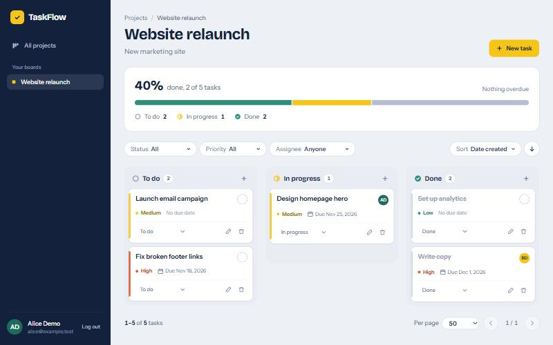
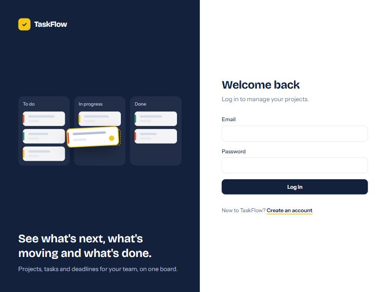
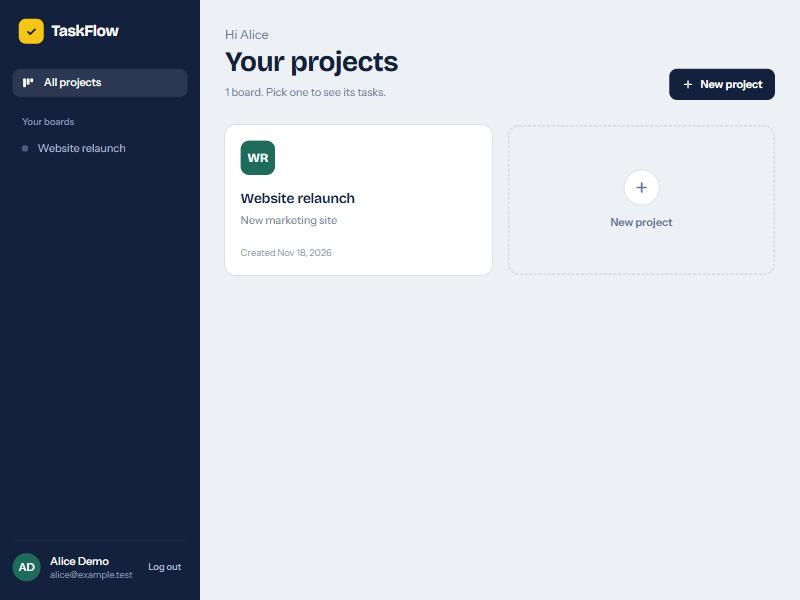
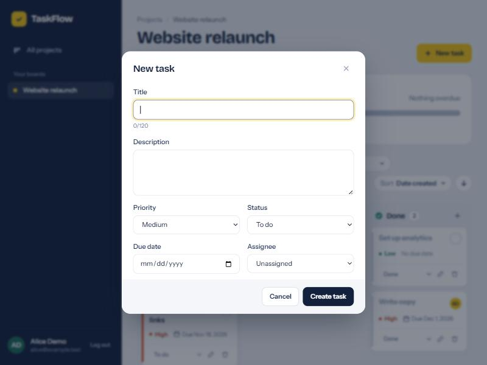

# TaskFlow – Team Task Management System

TaskFlow is a full-stack task manager. You register, create projects, and track each project's tasks on a three-column board (To do, In progress, Done), with filters, sorting, pagination and overdue highlighting.

**Live demo:** https://taskflow-three-pearl.vercel.app (frontend on Vercel, API and database on Render)
**Source:** https://github.com/prachicodehub/taskflow



| | |
|---|---|
|  |  |
|  | |

## Contents

1. [Tech stack](#1-tech-stack)
2. [Requirements checklist](#2-requirements-checklist)
3. [Running it](#3-running-it)
4. [Running the tests](#4-running-the-tests)
5. [API](#5-api)
6. [Design patterns](#6-design-patterns)
7. [Assumptions and trade-offs](#7-assumptions-and-trade-offs)
8. [Project layout](#8-project-layout)

More detail: [docs/ARCHITECTURE.md](docs/ARCHITECTURE.md) (design document) and [docs/GUIDE.md](docs/GUIDE.md) (a plain-language walkthrough of the code).

---

## 1. Tech stack

| Layer | Stack |
|---|---|
| Backend | Kotlin 2.2, Spring Boot 3.5, Spring Security (JWT + BCrypt), Spring Data JPA, Bean Validation |
| Database | PostgreSQL 16, schema managed by Flyway (H2 in PostgreSQL mode for tests and the no-Docker demo) |
| Frontend | React 18, TypeScript, Vite, TanStack Query, React Router, Axios, Tailwind CSS |
| Tests | JUnit 5 + MockK, `@SpringBootTest` + MockMvc, `@DataJpaTest`, Vitest + React Testing Library |
| Bonus | Docker Compose, Swagger UI, Flyway migrations, GitHub Actions CI, Vercel + Render deployment |

## 2. Requirements checklist

| Requirement | Status | Where |
|---|---|---|
| Register / login with JWT, BCrypt passwords | Done | `security/JwtService.kt`, `service/AuthService.kt` |
| All other endpoints require a valid token | Done | `config/SecurityConfig.kt`, `security/JwtAuthenticationFilter.kt` |
| Users only see their own projects and tasks | Done (404 for others' IDs) | `repository/*Repository.kt` (`findByIdAndOwnerId`), `service/OwnershipLookups.kt` |
| Projects: list, create, summary (per status + overdue) | Done | `controller/ProjectController.kt`, `service/ProjectService.kt` |
| Tasks: create, update, change status, delete | Done | `controller/TaskController.kt`, `service/TaskService.kt` |
| Filter by status / priority / assignee, sort by due date / priority, pagination | Done | `repository/TaskSpecifications.kt`, `service/task/TaskSortStrategies.kt` |
| Validation (title required, ≤ 120 chars, due date not in past) with field errors | Done | `dto/TaskDtos.kt`, `service/TaskService.kt` |
| One consistent error format (400 / 401 / 404 / 409) | Done | `exception/GlobalExceptionHandler.kt`, `security/SecurityErrorResponder.kt` |
| Frontend: login / register | Done | `pages/LoginPage.tsx`, `pages/RegisterPage.tsx` |
| Frontend: projects dashboard | Done | `pages/ProjectsPage.tsx` |
| Frontend: board with 3 columns + summary | Done (drag and drop too) | `pages/ProjectBoardPage.tsx`, `components/tasks/*` |
| Frontend: create / edit task modal | Done | `components/tasks/TaskFormModal.tsx` |
| Frontend: filters, sort, overdue highlight | Done | `components/tasks/TaskFilters.tsx`, `TaskCard.tsx` |
| Auto-logout when the JWT expires | Done | `context/AuthContext.tsx`, `api/axiosClient.ts` |
| At least 2 design patterns | Done (4 backend + 1 frontend) | [Section 6](#6-design-patterns) |
| Service unit tests (MockK) | Done | `backend/src/test/.../service/*Test.kt` |
| At least 1 integration test | Done (2 suites) | `backend/src/test/.../controller/*IntegrationTest.kt` |
| At least 2 React component tests | Done (4 components) | `frontend/src/components/**/*.test.tsx` |
| Bonus: Docker Compose, Swagger, Flyway, GitHub Actions | Done | `docker-compose.yml`, `/swagger-ui.html`, `db/migration/`, `.github/workflows/ci.yml` |

## 3. Running it

### Option A: Docker (whole stack, one command)

```bash
cp .env.example .env        # optional; the defaults work for a demo
docker compose up --build
```

| What | URL |
|---|---|
| App | http://localhost:3000 |
| API | http://localhost:8080/api |
| Swagger UI | http://localhost:8080/swagger-ui.html |

### Option B: Local without Docker or PostgreSQL (quickest)

Needs **JDK 21** and **Node 20.19+**.

```powershell
# Terminal 1: API on :8080 with an in-memory H2 database (data resets on restart)
cd backend
.\gradlew.bat bootRun --args="--spring.profiles.active=h2"

# Terminal 2: UI on :5173 (Vite forwards /api to :8080)
cd frontend
npm install
npm run dev
```

Open http://localhost:5173 and create an account. On macOS/Linux use `./gradlew` instead of `.\gradlew.bat`.

### Option C: Local with PostgreSQL

```powershell
docker compose up -d postgres          # or any local PostgreSQL 16
cd backend
$env:JWT_SECRET="<at least 32 random characters>"
.\gradlew.bat bootRun
```

Flyway creates the tables on startup from `backend/src/main/resources/db/migration`.

### Deploying (Vercel + Render)

1. **Backend on Render:** Dashboard → **New → Blueprint** → select this repo. `render.yaml` creates the API (Docker, from `backend/`) and a PostgreSQL database, connects them, and generates `JWT_SECRET`. Note the API URL, e.g. `https://taskflow-api.onrender.com`.
2. **Frontend on Vercel:** import the repo, set **Root Directory** to `frontend`, and add `VITE_API_BASE_URL=https://<your-api>.onrender.com/api`. `frontend/vercel.json` handles client-side routing.
3. Make sure the backend's `CORS_ALLOWED_ORIGINS` contains the Vercel URL.

Free Render services sleep when idle, so the first request after a while can take up to a minute.

### Configuration

| Variable | Default | Purpose |
|---|---|---|
| `DB_URL`, or `DB_HOST` / `DB_PORT` / `DB_NAME` | `localhost:5432/taskflow` | Database location |
| `DB_USERNAME` / `DB_PASSWORD` | `taskflow` / `taskflow` | Database login |
| `JWT_SECRET` | dev-only value | HS256 signing key, **at least 32 characters**. Always set it when deploying. |
| `JWT_EXPIRATION_MINUTES` | `60` | How long a login lasts |
| `CORS_ALLOWED_ORIGINS` | `http://localhost:5173` | Comma-separated frontend URLs allowed to call the API |
| `PORT` / `SERVER_PORT` | `8080` | HTTP port |
| `VITE_API_BASE_URL` (frontend) | `/api` | API address, needed only when the API is on another host |

## 4. Running the tests

```powershell
cd backend;  .\gradlew.bat test     # 49 tests
cd frontend; npm test               # 20 tests
cd frontend; npm run typecheck
```

| Suite | What it checks |
|---|---|
| `AuthServiceTest` | Register with a taken email → 409; wrong password → 401; emails are normalised |
| `ProjectServiceTest` | Only the owner's projects are listed; summary counts per status and overdue |
| `TaskServiceTest` | Create with a past due date → 400; someone else's task → 404; status change; assignee must exist |
| `TaskRepositoryTest` | Filters, priority sort (HIGH > MEDIUM > LOW), due-date sort with empty dates last, ownership queries |
| `AuthFlowIntegrationTest`, `TaskApiIntegrationTest` | Real HTTP calls through the whole app: register → login → project → tasks; 401 without a token; 404 for another user's project; 400 field errors |
| `LoginForm.test`, `TaskFormModal.test` | Validation messages, trimmed values submitted, server errors shown |
| `TaskCard.test`, `ProjectCard.test` | Rendering, overdue highlight (and not for done tasks), button handlers, links |

GitHub Actions runs both suites, the typecheck, the production build, and the Docker image build on every push.

## 5. API

Everything except register, login and Swagger needs `Authorization: Bearer <token>`. Swagger UI documents every endpoint: log in, click **Authorize**, paste the token, then use "Try it out".

| Method | Path | Notes |
|---|---|---|
| POST | `/api/auth/register` | `{name, email, password}` → 201 `{token, expiresAt, user}` |
| POST | `/api/auth/login` | `{email, password}` → 200 `{token, expiresAt, user}` |
| GET | `/api/auth/me` | The logged-in user |
| GET | `/api/users` | Users who can be assigned to tasks |
| GET / POST | `/api/projects` | List my projects / create one |
| GET | `/api/projects/{id}/summary` | `{total, todo, inProgress, done, overdue}` |
| GET | `/api/projects/{id}/tasks` | `?status=&priority=&assigneeId=&sort=createdAt\|dueDate\|priority&direction=asc\|desc&page=0&size=20` |
| POST | `/api/projects/{id}/tasks` | Create a task |
| PUT | `/api/tasks/{id}` | Update a task |
| PATCH | `/api/tasks/{id}/status` | `{status}` |
| DELETE | `/api/tasks/{id}` | 204 No Content |

Every error has the same shape:

```json
{
  "timestamp": "2026-11-18T10:15:30Z",
  "status": 400,
  "error": "Bad Request",
  "message": "Validation failed",
  "path": "/api/projects/3/tasks",
  "fieldErrors": [{ "field": "title", "message": "Title is required" }]
}
```

## 6. Design patterns

| Pattern | Where | Why |
|---|---|---|
| **Strategy** | `service/task/TaskSortStrategies.kt` | Each sort option (`createdAt`, `dueDate`, `priority`) is its own class, picked by `TaskSortStrategyResolver`. Adding a sort means adding one class; the service doesn't change. Priority sort ranks HIGH > MEDIUM > LOW instead of alphabetically. |
| **Specification** | `repository/TaskSpecifications.kt` | Each filter is a small reusable condition; only the filters in the request are combined into the query. |
| **Repository** | `repository/` | Spring Data interfaces hide SQL from the services and are easy to mock in tests. |
| **Mapper / Factory** | `dto/mapper/Mappers.kt` | All entity ↔ DTO conversion is in one place, so database entities never reach the controllers or the JSON. |
| **Interceptor / Observer** (frontend) | `api/axiosClient.ts`, `context/AuthContext.tsx` | One Axios instance adds the token to every request; a 401 from any call notifies `AuthContext`, which logs the user out. |

## 7. Assumptions and trade-offs

- **Ownership:** each project has one owner. Any registered user can be assigned a task, but assignment gives no access to the project, because there is no team/membership model. That keeps the access rule simple and safe; team membership would be the next feature.
- **404 instead of 403** for other users' projects and tasks, so nobody can probe which IDs exist.
- **Due dates:** a past due date is rejected when creating a task. When updating, it's checked only if the date changes, so an already-overdue task can still be edited or completed.
- **Overdue** means the due date is before today and the task isn't done.
- **Token storage:** the JWT is kept in `localStorage`. That's simple for a single-page app, but exposed if the site had an XSS bug; an httpOnly cookie with CSRF protection would be the hardened option.
- **No refresh tokens:** when the token expires, the user logs in again.
- **Board and pagination:** the board shows one page (50 tasks by default) of the filtered list across the three columns; the summary always covers the whole project.

## 8. Project layout

```
TaskFlow/
├── backend/                 Kotlin + Spring Boot API
│   └── src/main/kotlin/com/taskflow/
│       ├── config/          Security, CORS, Swagger, settings
│       ├── controller/      HTTP endpoints
│       ├── dto/             Request/response classes and mappers
│       ├── entity/          Database tables as classes
│       ├── exception/       Error handling
│       ├── repository/      Database queries
│       ├── security/        JWT creation and checking
│       └── service/         Business rules
├── frontend/                React + TypeScript
│   └── src/{api,components,context,hooks,pages,routes,types,utils}
├── docs/                    ARCHITECTURE.md, GUIDE.md, screenshots
├── docker-compose.yml       PostgreSQL + API + frontend
├── render.yaml              Render deployment (API + database)
└── .github/workflows/ci.yml Continuous integration
```
